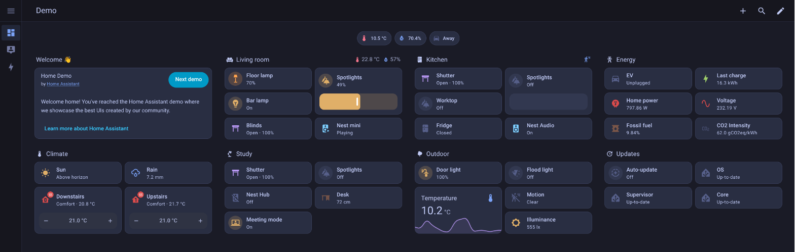
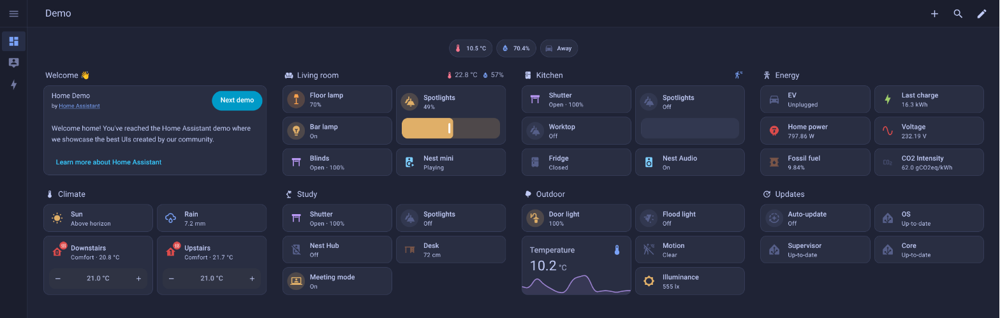
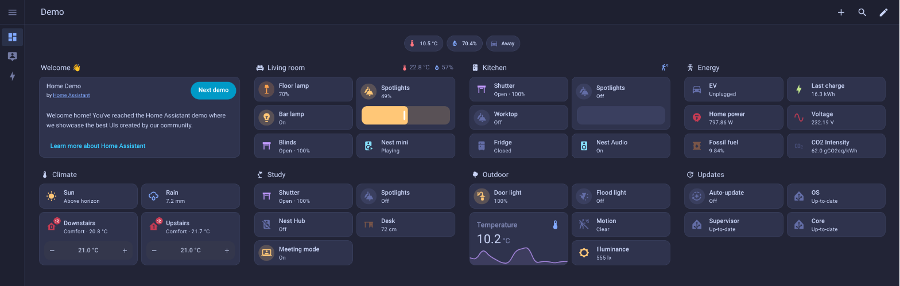
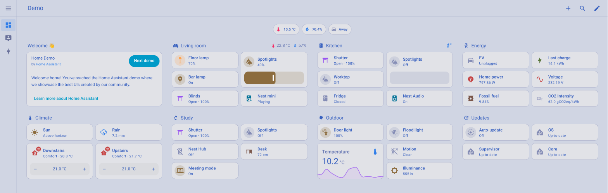

# Tokyo Night for Home Assistant

[](https://my.home-assistant.io/redirect/hacs_repository/?owner=williamcorsel&repository=ha-tokyo-night&category=theme)

The [Tokyo Night](https://github.com/folke/tokyonight.nvim) colour scheme as Home Assistant themes. All colours come from the official Tokyo Night palette.

The repository contains three themes. Each one has a dark and a light mode:

| Theme | Dark mode | Light mode |
|---|---|---|
| Tokyo Night | Night | Day |
| Tokyo Night Storm | Storm | Day |
| Tokyo Night Moon | Moon | Day |

## Screenshots

**Tokyo Night** (dark mode)



**Tokyo Night Storm** (dark mode)



**Tokyo Night Moon** (dark mode)



**Day** (light mode of all three themes)



## Installation

### HACS (recommended)

1. Click the **Open your Home Assistant instance** button above. If the button does not work, open HACS, select **⋮ → Custom repositories**, and add `https://github.com/williamcorsel/ha-tokyo-night` with the type **Theme**.
2. Download **Tokyo Night** in HACS.
3. Reload the themes: run the `frontend.reload_themes` action (in **Developer tools → Actions**, called **Tools** since Home Assistant 2026.8), or restart Home Assistant.

### Manual

1. Copy `themes/tokyo-night.yaml` to the `themes` folder in your Home Assistant configuration folder.
2. Reload the themes as in step 3 above.

### Theme folder setup

Home Assistant only loads themes from the `themes` folder if your `configuration.yaml` contains:

```yaml
frontend:
  themes: !include_dir_merge_named themes
```

If you add this line, restart Home Assistant once.

## Usage

1. Open your profile: select your name at the bottom of the sidebar.
2. Under **Theme**, select **Tokyo Night**, **Tokyo Night Storm**, or **Tokyo Night Moon**.
3. Select **Auto**, **Light**, or **Dark**. **Auto** follows the setting of your device.

To use a theme for all users, run the `frontend.set_theme` action:

```yaml
action: frontend.set_theme
data:
  name: Tokyo Night
  mode: dark
```

## Notes

- In Storm, the page uses Storm's darker background colours (`bg_dark` and `bg_dark1`). With the normal Storm background, the cards are almost the same colour as the page.
- The Day palette has less contrast than the dark styles. In light mode, small grey text can be hard to read.

## Credits

The colour palette is from [tokyonight.nvim](https://github.com/folke/tokyonight.nvim) by Folke Lemaitre (MIT License).
